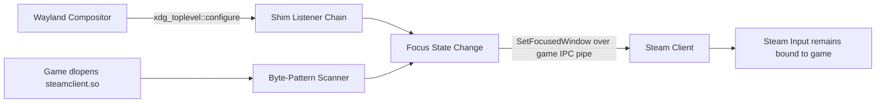

# How `wl-steaminput` Works

For setup and usage instructions, see the [README](README.md). This document covers the internal architecture: how the Steam client handles window focus, how the shim hooks Wayland and Steamworks at runtime, and how to interpret trace logs.

> **Build Note:** No specific CMake build type is required. However, building with plain `Debug` enables Dobby's internal logging, which dumps every hook's relocated assembly instructions into the trace output.

---

## Why the Steam Client Never Learns About Focus

Steam Input determines which controller profile to apply (for example, what the right trigger does) by checking which application currently has focus inside the Steam client.

Normally, that internal focus field is updated via `IClientUtils::SetFocusedWindow`, which the Steam Overlay renderer sends over the game's dedicated IPC pipe. Because the overlay renderer operates as a virtual X11 server, games running purely on Wayland—either natively or via `PROTON_USE_WAYLAND=1`—never communicate with it. Consequently, Steam assumes the desktop remains focused, and controller inputs actuate your desktop environment (e.g., KDE or GNOME) instead of the game.

Controller rendering, raw input, and haptics are unaffected; only this focus-binding link is missing.

---

## Architecture & Hooking Lifecycle

When `LD_PRELOAD` injects `wl-steaminput` at process startup, neither Wayland nor Steamworks has been loaded yet: games `dlopen` `libwayland-client` (via SDL3 or Wine's `winewayland.so`) when creating their first window, and `steamclient.so` when initializing Steamworks.

To handle this, the shim hooks `dlopen` and re-runs initialization for both halves after every library load. Because everything is resolved dynamically at runtime, the binary links only against `libc`, `libdl`, and `Dobby`.

### 1. Capturing Window Focus (Wayland)

* **Listener Chaining:** The shim intercepts `wl_proxy_add_listener` on the game's `xdg_toplevel` surface. Every `xdg_toplevel::configure` event delivers the complete state array of the window; the presence or absence of `XDG_TOPLEVEL_STATE_ACTIVATED` reliably determines focus regardless of event ordering.
* **Window Destruction:** Because Wayland compositors do not emit an unfocus event when an active window is destroyed, the shim also hooks `wl_proxy_destroy` to cleanly clear focus when a toplevel closes.
* **Multi-Instance Support:** This works identically for native Wayland games and Proton (`PROTON_USE_WAYLAND=1`, where Wine owns the surface). Rather than relying on `dlsym`—which only resolves the first symbol in load order—the shim inspects each loaded `libwayland-client` instance's own symbol table, ensuring hooks attach even if a game or Vulkan layer bundles its own copy.

### 2. Sending the Focus Report (Steam IPC)

* **Client Library Matching:** Both native games (via `libsteam_api.so`) and Proton games (via Wine's `lsteamclient.so`) map Valve's `steamclient.so` into memory. The shim matches the exact basename (`steamclient.so`) to avoid hooking Wine's wrapper.
* **Marshaling the Call:** Inside `steamclient.so`, Valve maintains a table of generated IPC call senders that marshal arguments by interface and method name. The shim invokes `SetFocusedWindow` using a 32-byte call context (referencing the sender table, pipe, and connection) constructed via the client's own internal builder.
* **Pipe Discovery:** The call must travel over the game's existing IPC pipe. Opening a new pipe is impossible because the client fulfills that request by querying the game's local IPC server for a slot—which does not exist, triggering a null-pointer dereference. Instead, the shim enumerates the open pipes already attached to the client's connection object and probes each one using Steam's internal language-query call. Decoy pipes (such as the overlay renderer's) do answer the probe, but for a different app id; the game's own pipe is the one that answers for the game.

### 3. Surviving Steam Client Updates

The only hardcoded constants in `wl-steaminput` are interface call-table indices and internal struct layouts. All function entry points and globals are located via **byte-pattern scanning**:

* Every pattern is verified to be unique (or disambiguated by a targeted predicate) and bounds-checked against the library's mapped memory segments before reading or executing.
* Each scan checks the standard `linux64` binary layout first, falling back to the Steam Runtime build layout. While compiler codegen differs slightly between the two, the call tables, 32-byte context layout, and pipe validation logic remain identical.
* **Fail-Safe Behavior:** If a future Steam update alters a signature, the shim logs a `waiting for the client` message and becomes a safe no-op rather than jumping into invalid memory. No client functions are invoked until the first real focus transition occurs, at which point the language probe simultaneously selects the valid pipe and verifies IPC responsiveness.

---

## Reading the Trace Log

When running with `WLSTEAMINPUT_DEBUG=1`, the shim writes diagnostic lines to `~/.local/share/Steam/logs/console-linux.txt`:

| Trace Line | Meaning |
| --- | --- |
| `hooked dlopen` | The shim initialized and is watching dynamic library loads for Wayland and `steamclient.so`. |
| `wayland hooked, client resolved` | Status update emitted after each `dlopen` showing which half of the bridge is ready. |
| `waiting for the client: <reason>` | Non-fatal status retried on the next focus event. Reasons (`no SteamAppId`, `not mapped`, `senders are not in`, `not the layout`, `no connection`, `no pipe`) indicate which prerequisite is still missing. |
| `<N> pipes` / `pipe N, links N/N, state N, language ...` | Lists every open pipe found on the client connection as the shim probes them to find the active Steam client pipe. |
| `reporting over pipe N, app id N` | Confirms which pipe answered the language probe and will be used for focus reporting. |
| `toplevel activated/deactivated, size WxH` | Emitted whenever any game window gains or loses compositor focus. |
| `SetFocusedWindow(N) over pipe P` | The actual IPC focus report sent to Steam: reports the game's AppID when a window is active, or `413080` (Steam's desktop controller configuration AppID) when unfocused. |

Internally, Steam's focus receiver maps an unfocused state to its internal desktop AppID (`202355`). However, explicitly reporting `202355` over IPC causes Steam to activate that internal app directly, which suspends controller polling entirely. The controller goes completely dead for several seconds until Steam's fallback timer transitions into the desktop configuration profile—causing the exact input drop-outs and mode flapping this shim exists to prevent.

By reporting `413080` (the desktop configuration AppID) directly, the shim lands Steam Input in the exact final state used by the native X11 path in a single IPC call. This ID is not hardcoded; the shim reads it dynamically from the client's own internal app comparison logic.
