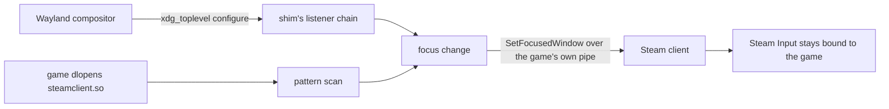

# How wl-steaminput works

The player-facing version is the README. This is the machinery: what the client
does with a focus report, where the shim finds it, and what every trace line
means.

Build notes: use RelWithDebInfo or Release — Dobby switches its own logging on
for `Debug` and dumps every hook's relocated instructions into the trace.

## Why the client never learns

Steam Input decides what an action bound to, say, the pad right trigger does by
looking at the focused app in the client. That field is written by
`IClientUtils::SetFocusedWindow`, which the overlay renderer normally reports
over the game's own pipe. The renderer is a virtual X server, so a game on
Wayland — natively or through Wine's Wayland driver — never talks to it, the
client keeps the desktop bound, and the button actuates KDE instead of the game.
Rendering and haptics are unaffected; only that focus binding is missing.

## How the shim works

Nothing worth hooking exists when the shim is loaded: games dlopen wayland (SDL3,
Wine's `winewayland.so`) when the first window appears and the client library
when they initialise Steamworks. So the shim hooks `dlopen` and retries both
halves after every load, which also means it links against nothing but libc,
libdl and Dobby.

Focus

Comes from the game's own `xdg_toplevel`: `wl_proxy_add_listener` is chained, and
every `configure` carries the whole window state, so the presence or absence of
`XDG_TOPLEVEL_STATE_ACTIVATED` says focused or not, repeatably and in any event
order. A toplevel destroyed while activated is a focus loss the compositor
promises no event for, so `wl_proxy_destroy` is hooked and retires it. Works for
a native Wayland game and for a Proton game on `PROTON_USE_WAYLAND=1`, where it
is Wine holding the window; every copy of libwayland in the process (the game's,
a layer's) is hooked through its own symbol table, because `dlsym` would answer
for only one.

The report

Goes through `steamclient.so`, which both kinds of game have mapped — native
through `libsteam_api.so`, Proton through Wine's `lsteamclient.so`, which loads
the client's own `sdk64` copy (hence the exact-basename match: the wrapper's name
ends with the client's). The client keeps a table of generated call senders; each
entry marshals one call's arguments and sends them over a pipe by interface and
method name. A call is made through a 32-byte context naming that table, the pipe
and the connection, built by the client's own builder.

The pipe must be the game's own, and one cannot simply be opened: the client
answers that request by asking the game's IPC server for a pipe slot, and that
server has none — it takes the request with a null dereference. So the pipes this
process already has are read off the client's connection object, and the client's
own language call picks the game's pipe: only the real client answers it. (The
overlay renderer's pipe is a candidate like any other, and will answer for the
wrong app.)

Surviving client updates

Positions in an interface's call table and the layout of the runtime objects are
the only numbers the shim hardcodes; everything else is found by byte patterns,
checked unique (or made unique by a predicate that says why), and verified inside
the library's own mappings before anything is read or called. Each pattern tries
the linux64 branch's shape first and the Steam Runtime branch's second — the two
differ in codegen only; the call table, the context layout and even the assert
inside the pipe validity check are identical. A client that moved something is a
`waiting for the client` log line, never a jump into data. Nothing is called
until the first focus change, and the first call is the language call, which both
picks the pipe and proves the client answers over it.

## Reading the trace

| Line | Meaning |
|---|---|
| `hooked dlopen` | the shim is in; both halves below appear as the game loads them |
| `wayland hooked, client resolved` | per-half progress after each `dlopen` |
| `waiting for the client: <reason>` | not fatal, repeated at the next focus change; `no SteamAppId`, `not mapped`, `senders are not in`, `not the layout`, `no connection`, `no pipe` name the missing piece |
| `<N> pipes` / `pipe N, links N/N, state N, language ...` | the client's own pipe inventory for this process, tried one by one |
| `reporting over pipe N, app id N` | the pipe the client answered a real call on |
| `toplevel activated/deactivated, size WxH` | every focus transition of every game window |
| `SetFocusedWindow(N) over pipe P` | the report itself: the game's id while any of its windows is activated, 413080 — the desktop's own Steam Input configuration — when none is |

Why 413080 and not "nothing focused"

The client's focus receiver settles an unfocus on its internal desktop app id
202355, but a report of that id activates it as itself, which suspends input
polling — the controller goes dead until the client's own fallback lands the
configuration app seconds later, which is the mode flapping this whole shim
exists to avoid. Reporting the configuration app directly lands the unfocus on
the same state the X11 path ends in, in one call. The id is not hardcoded: it is
read from the client's own internal-app comparison.

